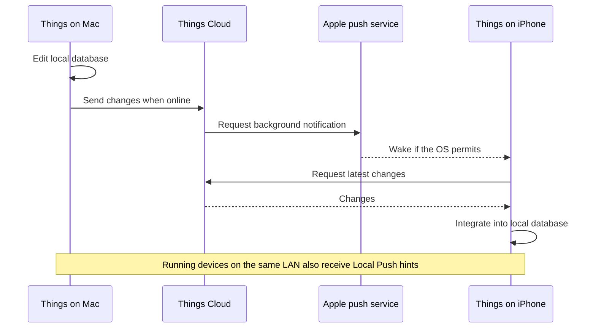
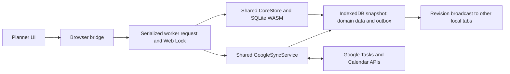
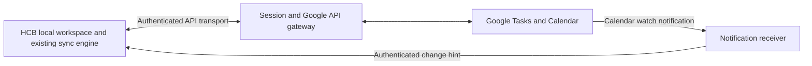

# Things Cloud and Google/local sync feasibility

Researched 2026-10-29 against HCB `eeaab4c`. This is an architecture assessment and implementation proposal, not a claim that the proposed features have shipped. External claims below use Cultured Code, Apple/WebKit, Swift.org, and Google documentation. Repository findings come from the current browser entry points and shared engine, not the retired Electron runtime.

This document preserves the research baseline. Subsequent changes and verification are tracked in [sync implementation progress](sync-implementation.md).

## Decision

We can substantially improve Google/local sync while retaining `CoreStore` and `GoogleSyncService`. Fast local edits, prompt outgoing delivery, efficient incoming updates, and automatic merging of independent edits are achievable. We already have much of the durability and recovery foundation.

The current static browser application cannot provide the complete Things experience: it loses authorization on reload, relies on polling for remote changes, and cannot silently run whenever a closed iPhone app needs updating. A small backend would address session continuity and Calendar notifications. Full HCB workspace replication and native background refresh would be additional projects.

Google remains the remote authority for Google-backed tasks and events. The first implementation should improve the existing engine and add infrastructure around it. It should not introduce a second task/calendar model or competing sync engines.

## What Things actually does

Things uses its own Things Cloud service for device synchronization. Its displayed calendar events are outside that service and must be enabled separately on each device. Consequently, its task-sync success does not demonstrate a solution for all of HCB's Calendar editing, recurrence, and Google interoperability requirements. [Things support](https://culturedcode.com/things/support/articles/2803586/)

### The documented change path

1. Each device has a full local database, so editing remains available offline. Changes are transferred as small updates rather than by uploading the whole database. [Current Things Cloud description](https://culturedcode.com/things/cloud/)
2. Editing and returning to the app trigger synchronization. On a shared network, Local Push tells other running Things instances to fetch cloud changes; the task data still travels through Things Cloud. The 2012 announcement describes an encrypted local notification, not peer-to-peer database replication. [Local Push](https://culturedcode.com/things/blog/2012/08/things-cloud-and-local-push/)
3. For background delivery, Things Cloud asks APNs to notify another device. The OS wakes Things, which fetches and integrates changes from Things Cloud. APNs carries the wake-up notification, not the task database. The 2015 Nimbus article described potentially minute-scale waits for dormant devices; that historical example is not a current latency guarantee. [Nimbus](https://culturedcode.com/things/blog/2015/08/things-cloud-nimbus-released/)
4. Fractus, introduced in 2021, transfers changed text fragments and improves text conflict resolution. It does not resend the entire note for every small edit. [Fractus](https://culturedcode.com/things/blog/2021/08/remarkable-notes/)

Apple explicitly treats background notifications as low priority, may delay/throttle them, and does not guarantee delivery. Opening the app must remain a recovery path even with native push. [Apple background notifications](https://developer.apple.com/documentation/usernotifications/pushing-background-updates-to-your-app)

### What is public about the merge engine and server

The engineers describe a foundation inspired by operational transformations and Git internals. Their 2025 architecture uses Swift/Vapor/SwiftNIO, Aurora MySQL, S3 for less-used data, Redis for ephemeral state, and APNSwift. They tested the replacement against mirrored production traffic and perform disruption testing. These are evidence for their engineering process, not prerequisites for HCB to copy their hosting stack. [Engineers' technical account](https://www.swift.org/blog/how-swifts-server-support-powers-things-cloud/)

The rewrite retained the established mathematical sync foundation. Cultured Code's May 2025 retrospective dates the service transition to early 2024 and later refinements to April 2025. Its reported fourfold improvement concerns sync request processing, not a measured fourfold improvement in phone-to-Mac convergence. [A Swift Cloud](https://culturedcode.com/things/blog/2025/05/a-swift-cloud/)

The public material does **not** specify the complete wire protocol, causal metadata, deletion rules, ordering algorithm, or exact merge decision for every conflict. It would be unjustified to call it a particular CRDT implementation, assume simple last-write-wins, or claim we can reproduce its proprietary protocol. The trace above combines documented mechanisms; it is not a packet capture of a Things account.

## Current HCB execution trace

The running product is React/Vite in a browser. Electron sources remain in the repository, but `pnpm dev` and the production build use the browser worker. See [browser migration](web-migration.md) and [Google browser setup](google-browser-setup.md).

The network operation currently remains inside the worker's exclusive workspace lock. BroadcastChannel coordinates tabs sharing this browser workspace; it does not connect a phone and Mac.

| Stage | Actual implementation | Consequence |
| --- | --- | --- |
| Authorization | [`googleAuth.ts`](../src/browser/googleAuth.ts), [`googleSyncSessions.ts`](../src/browser/googleSyncSessions.ts): GIS token popup, verified Google subject, token held in memory | Reload, expiry, or tab closure needs user-driven reconnection. A linked account still permits offline use. |
| Local edit | [`workspace.worker.ts`](../src/browser/workspace.worker.ts): serialized request, Web Lock, SQL transaction, `save()` | Domain data, outbox and undo become durable together before success returns. |
| Local persistence | [`indexedDb.ts`](../src/browser/indexedDb.ts): revision-checked snapshot commit | Other tabs cannot silently overwrite a newer workspace snapshot. This is local coordination only. |
| Scheduling | Worker `scheduleLocalSync()` and automatic timer | Writes debounce 500 ms in balanced mode or 150 ms in near-real-time mode. Incoming polls are nominally every 5 minutes or 30 seconds. Manual mode disables automatic work. |
| Reconnection/focus | [`bridge.ts`](../src/browser/bridge.ts), [`useWorkspaceRefresh.ts`](../src/renderer/src/features/shell/useWorkspaceRefresh.ts) | Connecting runs sync; returning online requests automatic sync. Focus/visibility currently refresh the local view, not an explicit Google pull. |
| Sync cycle | [`GoogleSyncService.sync()`](../src/shared/google/GoogleSyncService.ts) | Per account: pull enabled/granted Tasks and Calendar, deliver up to 100 ready outbox records, then pull again when writes were pending. |
| Tasks pull | `pullGoogleTasks()` | Lists are discovered, selected lists paginated, completed/hidden/deleted items included. `updatedMin` uses a one-second overlap from a first-response server-date watermark when available. |
| Calendar pull | `pullGoogleEvents()` | Per-calendar sync tokens; paginated pulls; `410` resets the token and performs a full reconciliation. Missing items are pruned only after a complete snapshot, protecting pending edits. |
| Remote write | `deliverOutbox()`, `pushTask()`, `pushEvent()` | Durable checkpoints surround remote effects. Conditional updates use stored ETags. Ordinary Calendar creates have deterministic IDs. Ambiguous Tasks creates stop for review. |
| Retry/recovery | [`CoreStore`](../src/shared/core/CoreStore.ts), [`sync resolution`](sync-conflict-recovery.md) | Backoff with jitter; eight failed retryable deliveries become conflicts. An unresolved write blocks later writes for the same account, preserving ordering. |

Two important qualifications: the debounce numbers describe when work is queued, not when Google acknowledges it; and the worker's 30-second timer can be suspended by the browser. The existing service worker caches application assets, not Google credentials or background sync work. See [`offlineShell.ts`](../scripts/build/offlineShell.ts).

### What already deserves to be retained

- Durable local edits and outbox, identity checks, account isolation, and granted-scope checks.
- Incremental Calendar pulls, Tasks timestamp overlap, deletion reconciliation, and recurring cancellation handling.
- Before-write checkpoints and after-write receipts, including failure restoration.
- Explicit treatment of uncertain task creation. Google accepting a request and the client losing its response is different from Google rejecting it.
- Conflict comparisons and reviewed recovery that preserve local work.

These are substantial correctness mechanisms, not disposable scaffolding.

### Gaps affecting the Things-like experience

**Authorization continuity is the first product gap.** Requiring a Google account does not give the browser a renewable sync session. The current account gate and the lifetime of API access are separate concerns.

**Remote visibility is timer-driven.** Changing a task in Google's phone app does not notify this browser. The receiving client can wait until its next poll, longer if suspended or unauthenticated. Local focus refresh does not remove that delay.

**Slow Google requests can delay local operations.** The worker holds both its request queue and the cross-tab writer lock during the sync cycle, including network waits. There is a 30-second per-request deadline, but several requests can accumulate. Yielding to the JavaScript event loop does not release this lock. This is a code-level risk; this audit did not measure its latency on a slow network.

**Conflict handling is conservative, not a field merge.** `upsertGoogleTask()` and `upsertGoogleEvent()` skip records with unresolved local mutations. Updates generally send a broad editable representation with its old ETag. A concurrent edit can require manual review even when the phone changed the title and HCB changed only the date. The current schema has no general stored sync baseline and field-change history supporting automatic three-way merging. Move/reorder and recurring-series operations require their own analysis; ETag safety must not be assumed for every multi-request path.

**Local commits export the database.** Changed durable checkpoints use a complete SQLite snapshot in IndexedDB. This is local persistence cost, not a whole-database Google upload. Measure export, persistence and lock wait separately before choosing a new storage backend; previous synthetic measurements are not cross-device sync benchmarks.

**Google data is only part of the workspace.** Task planning fields travel in an explicit versioned notes footer through [`hcbTaskMetadata.ts`](../src/shared/core/hcbTaskMetadata.ts). Native HCB Notes documents, preferences, stars, and local relationships are not a general cloud replica. A fresh device pulling Google is not equivalent to restoring this complete workspace. Do not confuse task notes with HCB's separate Notes feature.

## Google's capabilities and hard boundaries

| Capability | Published contract | HCB implication |
| --- | --- | --- |
| Calendar deltas | Final-page `nextSyncToken`, incremental changes including deletions, and full reset on `410`. [Sync guide](https://developers.google.com/workspace/calendar/api/guides/sync) | Keep the existing implementation; rebuild the remote mirror while retaining the local outbox. |
| Calendar notifications | HTTPS receiver, per-resource watch channels, explicit renewal, no event body, and possible dropped messages. [Push guide](https://developers.google.com/workspace/calendar/api/guides/push) | Add a backend notification hint and retain catch-up pulls. Push is an optimization, not the durable change history. |
| Tasks changes | The published REST surface has no `watch` method; listing exposes `updatedMin` and pagination, without a Calendar-style sync cursor. [REST surface](https://developers.google.com/workspace/tasks/reference/rest), [Tasks list](https://developers.google.com/workspace/tasks/reference/rest/v1/tasks/list) | Poll external Google Tasks edits. There is no documented API we can turn on to receive every task change instantly. |
| Concurrent modification | Calendar ETags reject stale writes with `412`; Google also documents partial update semantics and ETag use in its Tasks performance guide. [Calendar versions](https://developers.google.com/workspace/calendar/api/guides/version-resources), [Tasks partial updates](https://developers.google.com/workspace/tasks/performance) | Add baseline-aware merges and narrow patches. Preserve meaningful conflicts instead of unconditionally retrying with a new ETag. Validate endpoint-specific behavior live. |
| Task field fidelity | The public Task resource has date-only scheduling, limited text lengths, and no general custom app-state object. [Task resource](https://developers.google.com/workspace/tasks/reference/rest/v1/tasks) | Google cannot natively represent our complete workspace. Metadata-in-notes is interoperable only to the extent other editors preserve it. |
| Browser access | GIS token mode requires a user-driven request for a replacement access token. Code mode exchanges a code on a backend and can retain a refresh token there. [Token model](https://developers.google.com/identity/oauth2/web/guides/use-token-model), [Code model](https://developers.google.com/identity/oauth2/web/guides/use-code-model) | Persistent Google sessions require an auth architecture change. A timer or localStorage token copy does not solve this. |
| Closed iPhone web app | WebKit requires visible Web Push notifications; declarative push does not create a silent execution exemption. [WebKit explanation](https://webkit.org/blog/16535/meet-declarative-web-push/) | Do not promise native-style silent background refresh from the PWA. Refresh promptly when opened. |

Google's public API is the interoperability contract; we should not depend on private endpoints used by Google's own apps. Both Google applications and HCB can edit the same remote entities, so HCB alone cannot impose an operation-based merge protocol on every writer.

Polling needs an explicit quota budget. Google currently documents a 50,000-query daily courtesy quota for Tasks, while noting project quotas differ. Calendar also has project/user and operational limits, with changes introduced in May 2026. Check this deployment's console before choosing intervals. [Tasks quotas](https://developers.google.com/workspace/tasks/limits), [Calendar quotas](https://developers.google.com/workspace/calendar/api/guides/quota)

For illustration, the current Tasks pull with ten selected one-page lists needs at least eleven requests. Every 30 seconds for eight hours is **10,560 requests per device**, before writes or follow-up pulls. This is arithmetic from our call pattern, not a measured production load. Shortening every timer is not a viable scaling strategy.

## Recommended implementation sequence

### 1. Improve the existing browser engine

These are proposed atomic changes, in dependency order:

1. **Measure synchronization as separate stages.** Record local commit, queue wait, Google request/acknowledgement, pull, UI application, and cross-device convergence. Record account-safe operational IDs and counts, not note content or credentials. Surface saved locally, pending, synced, reconnect required, and conflict accurately.
2. **Unify automatic scheduling.** Add a debounced Google pull on foreground/resume, retain online triggers, prioritize ready writes, and pause unnecessary hidden-tab polling. Coordinate one active sync scheduler per local workspace while respecting per-tab sessions and takeover. Back off by service/account and quota budget; keep manual mode meaningful.
3. **Separate durable state access from network waiting.** Reserve an operation and commit intent under the lock; perform HTTP outside it; reacquire, refresh the revision, and apply a receipt only against the relevant operation/entity version. A response must not overwrite an edit made while it was in flight. Lease/generation fencing, interrupted-operation recovery and cross-tab takeover are prerequisites. Simply removing the lock is unsafe.
4. **Store the merge baseline.** Persist the last accepted remote representation/ETag and explicit local field changes. On divergence, compare base/local/remote. Merge independent fields; retry a bounded conditional patch; preserve overlapping or structurally ambiguous edits for review. Undo history is not an adequate sync baseline.
5. **Reduce redundant delivery.** Coalesce compatible unsent field edits with preserved undo semantics, send changed fields, and avoid a full all-resource round trip for each edit. Keep create-before-child, move-before-update and recurrence dependencies. Do not relax the account-wide ordering barrier until an explicit dependency model is tested.

Example merge policy: base title “Draft” and date Monday; phone changes title to “Send draft”; HCB changes date to Tuesday. The merged result can safely contain both changes. If both change the same date differently, retain a conflict. Deletion versus editing, list moves, ordering, attendees and recurrence need explicit policies; they are not ordinary scalar merges.

Text merging can later use a baseline and conservative diff/merge, but Google still receives the resulting string. That would not recreate Fractus's end-to-end fragment protocol. Preserve both versions when safe merging is uncertain.

### 2. Add a small backend for continuity and notifications

For a dependable browser product, this is the recommended next architecture after the shared-engine work:

- Introduce server sessions and Google authorization-code exchange. Store refresh credentials securely on the server, bind them to verified account identity, and handle revocation and reconnect. Keep credentials out of workspace exports. The local linked-account flag must never authorize a server request.
- Provide a narrow authenticated Google transport adapter for the existing engine, with account/resource authorization, rather than a separate CRUD/sync implementation. Keep retry/uncertain-write decisions in one place; a proxy must not independently replay an ambiguous Tasks creation.
- Add Calendar watch registration/renewal and an authenticated SSE or WebSocket hint to active clients. Validate channel identity and secret tokens, coalesce notifications, tolerate duplicates, and recover missed hints through polling/resume. Scope hints to the correct account/calendar.
- Keep Tasks on an adaptive polling budget. HCB-originated acknowledged writes may hint other active HCB devices to refresh sooner; external Google Tasks edits still wait for discovery.

This thin backend need not initially store a second task/calendar database. It solves durable authorization and notification transport. It does **not** by itself make a closed browser execute sync or synchronize native HCB Notes.

If later scale requires a server-owned Google mirror, migrate Google pull/delivery responsibility into an account-level worker using the shared logic. Clients then synchronize with that service using a documented protocol. Do not leave two independently authoritative Google delivery pipelines running for the same operations.

### 3. Decide whether full HCB phone/Mac replication is a product requirement

If the requirement is “Google Tasks/Calendar on my phone agrees with HCB,” stages 1–2 address the relevant scope, subject to Tasks polling and Google field limitations.

If the requirement is “every HCB note, preference, relationship and edit follows me between HCB devices,” we need an app-state replication service or another explicitly designed cloud store. That entails stable cross-device IDs, change cursors, deletion records, idempotent operation receipts, schema migration, account isolation, and conflict policy. Google sign-in can remain mandatory without making every HCB entity a Google Task.

If background-ready iPhone data comparable to Things is essential, add a native mobile execution path with native push/background handling and shared sync semantics. A wrapper alone does not supply those capabilities. Native delivery still obeys Apple's scheduling limits. Restoring an Electron shell would likewise not add a Google Tasks notification API.

## Acceptance criteria before promising Things-level sync

Treat these as proposed tests and goals, not measurements already achieved:

| Scenario | Required evidence |
| --- | --- |
| Ordinary online edit | Durable local acknowledgement independent of Google latency; record p50/p95 local save and outgoing acknowledgement. Initial target: small edits reach Google within a few seconds on a defined healthy network. |
| Foreground return | Immediate scheduled catch-up without manual refresh, drafts retained, one coordinated scheduler, no burst of duplicate polls. |
| Calendar hint | Open client applies an update promptly after the hint; also converges when hints are missing, duplicated, delayed, or channels expire. Measure provider notification delay separately. |
| External Google Tasks edit | Convergence within the configured active polling interval plus network/processing time under stated conditions. Publish the interval and request budget rather than calling it instant. |
| Two devices offline | Disjoint edits merge; overlapping edits remain recoverable; deletes, moves, subtasks, ordering, task metadata, and recurrence converge without duplication. |
| Crash/lost response | Kill before HTTP, after remote acceptance, and before receipt persistence. Safe Calendar retry and uncertain Tasks creation must survive restart. |
| Busy local workspace | With injected 10–30-second HTTP waits, local reads/edits and another tab remain usable after lock refactoring. A stale response cannot erase a newer edit. |
| Session lifecycle | Reload, browser restart, revoked consent, partial scopes, wrong-account reconnect, and refresh races preserve pending work and correct account boundaries. |
| Full recovery | Paginated pull interruption, Calendar `410`, list/calendar removal, device clock skew, unavailable server-date headers, quota errors and retry exhaustion. Never replace the user's outbox with a clean remote snapshot. |
| Actual devices | Disposable Google resources: HCB on Mac + Google apps on iPhone, then HCB browser/PWA on both; test Wi-Fi/cellular, backgrounding, reopening and prolonged offline use. Measure these paths separately. |

HCB Notes and local relationships need an explicit fresh-device fidelity test before any full-workspace sync claim. Export/import remains recovery, not continuous replication.

## Verification and limits of this assessment

The existing focused suites passed **117 tests** on 2026-10-29: browser authentication (11), browser sync/durable boundaries (17), sync unit behavior (23), and SQLite sync integration (66). All Google traffic in those suites is mocked. The integration run used an isolated temporary database root.

The first run encountered a local `better-sqlite3` ABI mismatch left from the Electron runtime. `corepack pnpm rebuild better-sqlite3` repaired the development dependency for Node 24; the full focused rerun passed. No application code, lockfile, Google account data, or deployed service was changed by this research.

No live Things traffic was captured, no real Google account was modified, and no phone-to-Mac latency benchmark was performed. Current Google project quotas, production OAuth setup, endpoint-specific edge behavior, and device background timing still require live verification. The recommended next work is the five shared-engine changes in stage 1, followed by the session/notification backend if seamless reconnect-free browser sync is required.
